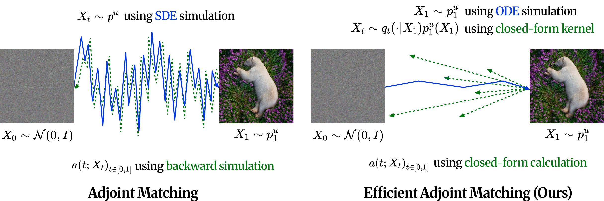

<p align="center">
<h2 align="center">Efficient Adjoint Matching for Fine-tuning Diffusion Models</h2>
</p>
<p align="center">
  <p align="center">
    <a href="https://swswss.github.io/">Jeongwoo Shin</a><sup>1*</sup>
    ·
    <a href="https://zero-DS.github.io/">Dongsoo Shin</a><sup>1*</sup>
    ·
    <a href="https://yuchen-zhu-zyc.github.io/">Yuchen Zhu</a><sup>2</sup>
    ·
    <a href="https://alexandreguo2001.github.io/">Wei Guo</a><sup>2</sup><br>
    <a href="https://yongxin.ae.gatech.edu/index.html">Yongxin Chen</a><sup>2</sup>
    ·
    <a href="http://www.joonseok.net/home.html">Joonseok Lee</a><sup>1†</sup>
    ·
    <a href="https://sites.google.com/view/jaewoongchoi/home?authuser=2">Jaewoong Choi</a><sup>3†</sup>
    ·
    <a href="https://jaemoo-choi.github.io/">Jaemoo Choi</a><sup>2†</sup><br>
    <sup>1</sup>Seoul National University <sup>2</sup>Georgia Institute of Technology <sup>3</sup>Sungkyunkwan University<br>
    <sup>*</sup>Equal contribution · <sup>†</sup>Corresponding author
  </p>
  <h3 align="center"><a href="https://arxiv.org/abs/2605.11480">Paper</a></h3>
</p>

---

<p align="center">
  <a href="assets/intro.pdf"></a>
</p>

This repository contains the code to fine-tune **Stable Diffusion 3.5 Medium** (LoRA) with a
differentiable reward using **EAM**, together with the **Adjoint Matching (AM)** baseline and the
DrawBench evaluation used for both.

- `train_eam.py` — EAM (single reward: PickScore; multi reward: PickScore + HPSv2.1 + Aesthetic)
- `train_am.py` — Adjoint Matching baseline (single / multi reward)
- `evaluate.py`, `eval_metrics.py` — DrawBench generation + PickScore, ImageReward, Aesthetic, CLIPScore, HPSv2.1

## Repository layout

```
config/sd3.py                 shared config (model, resolution, optimizer, sampler)
train_eam.py                  EAM training
train_am.py                   AM training
common.py                     distributed helpers, embedding dataset, SD3.5 + LoRA setup
eam_utils.py / am_utils.py    differentiable reward gradients
text_embedding_store.py       pre-computes the SD3.5 text embeddings
evaluate.py                   DrawBench image generation + PickScore
eval_metrics.py               5 metrics on the generated images
flow_grpo/                    samplers (DPM-Solver, memoryless flow SDE) and reward models
dataset/pickscore/            training prompts (train.txt: 25,432, test.txt: 2,048)
dataset/drawbench/test.txt    evaluation prompts (200 DrawBench prompts x 5 = 1,000 lines)
scripts/                      ready-to-run shell scripts (below)
```

## Installation

```bash
conda create -n eam python=3.10 -y
conda activate eam
pip install torch==2.6.0 torchvision==0.21.0 --index-url https://download.pytorch.org/whl/cu124
pip install -r requirements.txt
```

SD3.5-Medium is a gated model: accept its license on
[Hugging Face](https://huggingface.co/stabilityai/stable-diffusion-3.5-medium) and run `huggingface-cli login`.
PickScore, CLIP and ImageReward weights are downloaded automatically on first use.

## Data and reward checkpoints

```bash
# 1. SD3.5 text embeddings of the PickScore prompts (1 GPU, ~44 GB on disk)
bash scripts/precompute_embeddings.sh          # -> dataset/pickscore/embeddings/

# 2. HPSv2.1 and aesthetic-predictor weights (needed for multi reward and evaluation)
bash scripts/download_reward_ckpts.sh          # -> reward_ckpts/
```

## Training

All scripts assume 4 GPUs (A100 40GB) and are run from the repository root (`NUM_GPUS` sets the
number of GPUs).

| script | method | reward | batch / optimizer step (per GPU) |
|---|---|---|---|
| `scripts/train_eam_single.sh` | EAM (**default**) | PickScore | 8 x 16 = 128 prompts |
| `scripts/train_eam_multi.sh`  | EAM | PickScore + 0.5 HPSv2.1 + 0.02 Aesthetic | 128 prompts |
| `scripts/train_am_single.sh`  | AM  | PickScore | 8 x 4 x 4 timesteps = 128 states |
| `scripts/train_am_multi.sh`   | AM  | 2 PickScore/26 + HPSv2.1 + 0.04 Aesthetic/10 | 128 states |

```bash
bash scripts/train_eam_single.sh
```

**Multi-GPU behavior.** The scripts reproduce our runs, where LoRA gradients are *not* averaged
across GPUs:
- Each GPU trains its own copy of the adapter on its 1/N shard of the prompts.
- The rank-0 adapter is the one that is saved.
- For PickScore with 4 GPUs, this gives 49 optimizer steps per epoch.

The reason is that the transformer is offloaded to CPU during the reward pass. That device move
disconnects DDP's gradient hooks. Add `--sync_grads` to either training script for standard
data-parallel training, which uses an explicit all-reduce of the LoRA gradients (batch x accumulate x
N GPUs per step). This mode was not used for the reported settings.

Runs are written to `checkpoints/<run_name>/`:
- `checkpoints/iter_e{epoch}_i{iter}/lora_current_policy/`: LoRA adapters.
- `checkpoints/final/`: the adapter at the end of training.
- `samples/`: fixed-seed images rendered during training.
- `log.txt`: their rewards (EAM, with `--eval_reward`).

### EAM objective

For each prompt, `x1` is sampled from the current model with the deterministic DPM-Solver. A timestep `t`
is drawn from the 1000-step scheduler grid, with half of each batch on the noise side and half on the image side.
The noisy sample is `x_t = t x1 + (1 - t) eps`. The LoRA velocity is regressed onto

```
v_target = (2c-1) t^2 / D * v_base(x_t)  +  (1-t)^2 / D * (eps - x1)  -  eps_scale * (2c-1) t (1-t) / D * eps
           -  min((1-t)^0.9 / max(t,0.02)^1.5, reward_coeff_max) * lambda_reward * ∇_{x1} R(x1),      D = 2c t^2 - 2t + 1
```

- `v_base` is the frozen pretrained velocity.
- Each sample's squared error is weighted by `max(t,0.02)^1.5 / (1-t)^0.9`.

Main arguments of `train_eam.py`:

| argument | default script value | meaning |
|---|---|---|
| `--lambda_reward` | 52000 | reward scale. PickScore enters as PickScore/26, so 52000 = 2000 x raw PickScore |
| `--c` | 1 | coefficient `c` above |
| `--eps_scale` | 0 | weight of the epsilon term |
| `--training_nfe` | 40 (single) / 10 (multi) | DPM-Solver steps used to sample `x1` |
| `--reward_model` | `pickscore` / `multi` | `multi` = PickScore/26 + `--hpsv2_scale` HPSv2.1 + `--aesthetic_scale` Aesthetic + `--clip_scale` CLIPScore/100 |

### Adjoint Matching baseline

`train_am.py` ports Adjoint Matching to the SD3.5 flow model. Each step has three parts:
1. It samples 40-step trajectories with the memoryless flow SDE.
2. It solves the adjoint ODE backward from `-lambda ∇R` with the frozen base model, using one VJP per step.
3. It regresses the LoRA control onto the adjoint at `--num_train_timesteps` stratified states per trajectory.

## Evaluation

`scripts/eval.sh` evaluates a single checkpoint, or the base model when the adapter argument is empty. The protocol:
- DrawBench: 200 prompts, each listed 5 times in `test.txt` (1,000 images per seed), at 512x512.
- Deterministic DPM-Solver-2 with 10 steps and no CFG (guidance 1.0), in bf16.
- One image per prompt, seeded with `seed + prompt_index`.

```bash
bash scripts/eval.sh checkpoints/<run_name>/checkpoints/<iter>/lora_current_policy eval/<name> 42
bash scripts/eval.sh "" eval/sd35m_base 42          # pretrained SD3.5-Medium
```

Outputs in `eval/<name>/s<seed>/`:
- `pickscore_summary.json`: PickScore/26; `pickscore_mean_x26` gives the usual ~20 scale.
- `eval_5_metric_summary.json`: ImageReward, PickScore/26, Aesthetic, CLIPScore, HPSv2.1.
- `images/`: the generated images.

We average over seeds 42, 77, 369 and 2000.

## Acknowledgements

The samplers and reward-model wrappers in `flow_grpo/` are adapted from
[Flow-GRPO](https://github.com/yifan123/flow_grpo) and [MixGRPO](https://github.com/Tencent-Hunyuan/MixGRPO).
